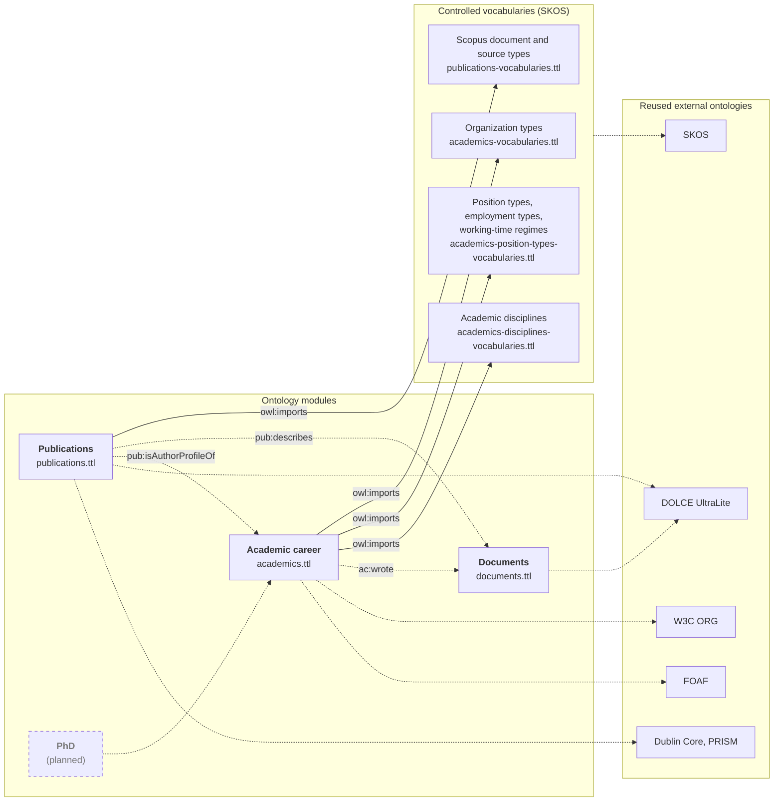

# FOSSR Ontology Network: scholars, careers and publications

A modular OWL ontology, with companion SKOS vocabularies, for describing **scholars and their academic careers** and the **publications** attributed to them, developed in the FOSSR project (*Fostering Open Science in Social Science Research*).

The ontology is designed to integrate data from heterogeneous sources into a single knowledge graph. These sources include bibliographic databases such as Scopus, institutional staff directories such as the CNR one, and the MUR services and classifications for Italian universities. The knowledge graph can then answer questions such as:

- Which positions has a scholar held, at which institutions and units, with which position type, and in which period?
- In which scientific disciplinary sector (SSD) or recruitment field is a position placed, in the 2015 and in the 2024 Italian classification?
- Which publications does a data source attribute to a scholar, and with whom has the scholar co-authored?
- Which records from different data sources describe the same publication, author or organization?

## Contents

- [Design principles](#design-principles)
- [Modules](#modules)
- [Controlled vocabularies](#controlled-vocabularies)
- [Namespaces](#namespaces)
- [Diagrams](#diagrams)
- [Status and roadmap](#status-and-roadmap)
- [Sources and licensing](#sources-and-licensing)

## Design principles

- **Modularity.** The ontology is a network of modules. Each module covers a coherent part of the domain and can be used and extended independently.
- **Records vs. real-world entities.** The publications module describes what each data source *says* (records: publication records, author profiles, organization profiles, venues). The documents and academic-career modules describe the *real-world* entities (documents, scholars). Records are linked to entities through `pub:describes`, and records of different sources describing the same entity are linked through `pub:hasAlias`. This makes it possible to keep the provenance of every statement and to reconcile conflicting sources.
- **Reuse of standards.** Careers are modelled on the W3C Organization Ontology (`org:Membership`, `org:FormalOrganization`, `org:OrganizationalUnit`, `org:Role`). Persons build on FOAF, documents on DOLCE UltraLite information objects, and bibliographic metadata on Dublin Core and PRISM.
- **Classifications as SKOS vocabularies.** Position types, employment types, working-time regimes, organization types, disciplinary classifications, and Scopus document and source types are SKOS concepts in separate vocabulary files, typed with the classes of the modules (e.g. `ac:PositionType`). New values can be added without changing the schema, and successions between editions of a classification are recorded with `dct:replaces` / `dct:isReplacedBy`.
- **Documented design.** Every module and most vocabularies come with a Graffoo diagram (yEd `.graphml`), kept in sync with the Turtle files.

## Modules

*Solid arrows: `owl:imports`. Dotted arrows: references to terms of another module or reuse of external vocabularies. This figure is updated as new modules are added.*

| Module | What it represents | Ontology IRI (prefix) | Turtle | Graffoo diagram |
|---|---|---|---|---|
| **Academic career** | Scholars and their careers. A *position* (`ac:Position`, an `org:Membership`) is the continuous service of a scholar at an institution (the legal entity, e.g. a university or CNR) with a given position type and employment type. Within a position, the module records dated attachments to home units (departments, institutes) and secondments, the site of work, and the working-time regime over time. Each position is placed in the Italian classification of academic disciplines (2015 system: settore concorsuale + SSD; 2024 system: GSD + SSD). The module also covers authorship of documents and co-authorship relations between scholars. | `https://w3id.org/fossr/onto/academic-career` (`ac:`) | `academics.ttl` | `academics.graphml` |
| **Publications** | What bibliographic data sources (currently Scopus) state about publications, authors, organizations and venues: publication records with ordered author and reference lists, author profiles and names, organization profiles and their hierarchy, venues and venue issues, identifiers (DOI, Scopus ID, ORCID, ISSN, ISBN…), data sources and classifications. Every record is extracted from exactly one data source and is linked to the real-world entity it describes. | `https://w3id.org/fossr/onto/publications` (`pub:`) | `publications.ttl` | `publications.graphml` |
| **Documents** | Real-world documents (scholarly publications, project deliverables, reports, administrative documents such as minutes), independent of the data sources that describe them. | `https://w3id.org/fossr/onto/documents` (`doc:`) | `documents.ttl` | — |
| **PhD** *(planned)* | Doctoral education: PhD programmes, cycles, supervision and theses. | — | — | placeholder in `academics.graphml` |

## Controlled vocabularies

The vocabularies are SKOS concept schemes, kept in separate files so that they can be updated (e.g. when a new decree changes a classification) without touching the modules. Each concept is typed with the class of the module it belongs to. The Ontology IRI column gives the IRI declared in each file. Concept IRIs use the prefix `https://w3id.org/fossr/vocab/<scheme>/`.

| File | Ontology IRI | Concept schemes | Content | Used by | Graffoo diagram |
|---|---|---|---|---|---|
| `academics-vocabularies.ttl` | `https://w3id.org/fossr/vocab/academics-organizations` | `vocab:organization-types` `vocab:it-university-types` | **Organization types**: FOSSR types of organizations (university, research organization, company, foundation, consortium, association) and of their units (school, department, institute, interdepartmental centre, research group, laboratory), with mappings to VIVO classes (`skos:closeMatch`). **Italian university types** of the MUR Cercauniversità service (state, non-state, online, for foreigners, special institutes, superior schools, advanced doctoral institutes), each a `skos:broadMatch` of *university*. Used with `org:classification`. | Academic career | `academics-vocabularies.graphml` |
| `academics-position-types-vocabularies.ttl` | `https://w3id.org/fossr/vocab/academics` | `vocab:it-university-position-types` `vocab:it-epr-position-types` `vocab:employment-types` `vocab:working-time-regimes` | **Position types (qualifiche)** of Italian universities (professors of first and second tier, permanent and fixed-term researchers including RTDa, RTDb and RTT, pre-tenure positions, historical figures), with the Cercauniversità strings as `skos:hiddenLabel` and successions between figures (`dct:replaces`). **Position types of Italian public research organizations** (EPR: researchers, technologists, technical and administrative staff), with the levels I–VIII as `skos:Collection`s. **Equivalent tiers** between universities and EPRs (collections `grade-it:fascia-1/2/3`, after D.M. 367/2022). **Employment types** (permanent, fixed-term, research grant, collaboration; *provisional*) and **working-time regimes** (full time, definite time, part time). | Academic career | `academics-position-types-vocabularies.graphml` |
| `academics-disciplines-vocabularies.ttl` | `https://w3id.org/fossr/vocab/academic-disciplines` | `vocab:it-cun-areas` `vocab:it-academic-disciplines-2015` `vocab:it-academic-disciplines-2024` | **Italian classification of academic disciplines.** The 14 CUN areas, shared by both systems. The 2015 system (D.M. 855/2015): 88 macro-sectors, 190 settori concorsuali, 371 SSDs. The 2024 system (D.M. 639/2024): 190 gruppi scientifico-disciplinari (GSD), 367 SSDs. 2015 concepts are linked to their 2024 successors with `dct:isReplacedBy` and to the AgID/OntoPiA vocabulary with `skos:exactMatch`. | Academic career | — (the classes are shown in `academics.graphml`) |
| `publications-vocabularies.ttl` | `https://w3id.org/fossr/vocab` | `vocab:scopus-document-types` `vocab:scopus-source-types` | **Scopus document types** (values of the Scopus `subtype` field, e.g. article, conference paper, book chapter) and **Scopus source types** (values of `prism:aggregationType`, e.g. journal, book series, conference proceeding), with Scopus as data source and issuer. | Publications | `publications-vocabularies.graphml` |

Each concept scheme states the authority that issues it (`pub:issuedBy`, e.g. MUR, Scopus, FOSSR) and, where applicable, its normative or documentary source (`dct:source`).

## Namespaces

| Prefix | Namespace |
|---|---|
| `ac:` | `https://w3id.org/fossr/onto/academic-career/` |
| `pub:` | `https://w3id.org/fossr/onto/publications/` |
| `doc:` | `https://w3id.org/fossr/onto/documents/` |
| `vocab:` | `https://w3id.org/fossr/vocab/` |
| `org:` | `http://www.w3.org/ns/org#` |
| `foaf:` | `http://xmlns.com/foaf/0.1/` |
| `skos:` | `http://www.w3.org/2004/02/skos/core#` |
| `dul:` | `http://www.ontologydesignpatterns.org/ont/dul/DUL.owl#` |
| `dc:` / `dct:` | `http://purl.org/dc/elements/1.1/` / `http://purl.org/dc/terms/` |
| `prism:` | `http://prismstandard.org/namespaces/basic/2.0/` |

## Diagrams

The `.graphml` files are diagrams in the [Graffoo](https://essepuntato.it/graffoo/) notation (Graphical Framework for OWL Ontologies) and can be opened and edited with [yEd](https://www.yworks.com/products/yed). In Graffoo:

- yellow rectangles are classes;
- green parallelograms are datatypes;
- pink circles are individuals;
- blue arrows are object properties and green arrows are datatype properties;
- black arrows are `rdfs:subClassOf` and `rdf:type`.

The diagrams are the reference for the design of each module, and the Turtle files are kept consistent with them.

## Status and roadmap

The ontology is under active development; each file states its version in `owl:versionInfo`.

- **Academic career**, **Publications**, **Documents**: draft modules, in use for data integration.
- **PhD module**: planned.
- **Employment types**: provisional, to be checked against the values of the data sources (e.g. the CNR staff directory).
- **Position types of public research organizations**: the source strings of the CNR staff directory are still to be added as `skos:hiddenLabel`.
- **Other data sources** (e.g. Web of Science) and further classifications (e.g. ERC panels) can be added as new vocabularies without changing the modules.

## Sources and licensing

- The 2015 concepts of `academics-disciplines-vocabularies.ttl` are derived from the AgID/OntoPiA vocabulary [academic-disciplines](https://w3id.org/italia/controlled-vocabulary/classifications-for-universities/academic-disciplines) (CC BY 4.0). The 2024 concepts are taken from [D.M. 639/2024](https://www.mur.gov.it/it/atti-e-normativa/decreto-ministeriale-n-639-del-02-05-2024) (Allegati A, B and C).
- University position types and university types follow the MUR [Cercauniversità](https://cercauniversita.mur.gov.it) service. The equivalence between university and research organization tiers follows D.M. 367/2022.
- Scopus document and source types follow the Scopus documentation and the values observed in Scopus records.

**License:** *to be defined.*
